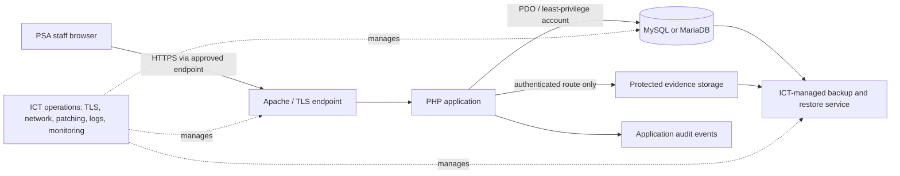

# PSA-SAMS system blueprint

**Public Service Academy Stores and Asset Management System**  
**Document purpose:** product and technical blueprint for PSA leadership, ICT, stores, and operational stakeholders.  
**Status:** implementation baseline prepared for an ICT-managed pilot assessment. This document is not a production approval, policy decision, or security certification.

## 1. Executive summary

PSA-SAMS is a role-controlled web application for recording and reviewing Academy assets, consumable inventory, stock requests, asset movements, physical verification, maintenance, user access, and operational reports.

The current application is built with PHP 8, PDO, and MySQL/MariaDB. It is designed to run behind Apache and an approved HTTPS endpoint. Local XAMPP is for development and demonstration only. The system should move to a PSA/ICT-managed pilot environment before staff use it for operational records.

The system provides transaction records and application audit events for implemented workflows. It does not replace PSA finance, procurement, human-resources, records-management, identity, email, or formally approved audit systems. No such integrations are assumed.

## 2. Outcomes and boundaries

### Intended outcomes

- Maintain a searchable register of tagged assets and their department, custodian, location, condition, and verification state.
- Record assignment, return, and department-transfer workflows.
- Track consumable items, receipts, reorder levels, and separately requested, approved, and issued stock.
- Record maintenance work, physical verification campaigns, found/missing checks, and optional protected image evidence.
- Give authorized users dashboard indicators, in-app alerts, printable reports, CSV extracts, and application audit history.
- Provide administrator-managed user accounts and core reference data.

### Out of scope until PSA commissions and approves it

- Finance/procurement policy, valuation, depreciation, procurement, payment, or accounting integration.
- Single sign-on, HR directory synchronization, email/SMS, external APIs, or scheduled/background jobs.
- Electronic signatures or proof of non-repudiation.
- Tamper-evident audit logging, a records-retention engine, evidence malware scanning, or evidence encryption at rest.
- Mobile camera barcode scanning, QR codes, offline operation, or native mobile applications.
- PSA-approved authority limits, department-level data segregation rules, retention periods, and verification cadence.

## 3. User roles and access model

The application has five configured roles. The table summarizes the current route-level navigation and permission checks; ICT and policy owners must confirm that they match PSA delegations before a pilot.

| Role | Current access summary |
|---|---|
| Super administrator | All operational modules; user administration; department and asset-category reference data. |
| Administration officer | Assets, stores, requisitions, physical verification/campaign administration, transfers/allocations, maintenance, and dashboard. |
| Stores officer | Assets, stores, requisitions, physical verification, transfers/allocations, maintenance, and dashboard. |
| Approving officer | Requisition and transfer decisions, dashboard, and reports/audit. |
| Management | Dashboard and reports/audit; no operational write workflow. |

Authorization is enforced by server-side role checks, not just by hiding navigation links. Accounts can be deactivated; password resets require a forced password change; password changes invalidate other sessions for that account. The installed local database currently has only one active user, so multi-person approval/issue acceptance testing remains outstanding.

## 4. Operational workflows

### Asset lifecycle

1. An authorized officer registers an asset with a unique tag and required category and department.
2. Authorized staff assign an asset to an active user, record a return, or request a department transfer.
3. A different authorized officer decides a pending transfer. Approval updates the asset's department only after checks pass.
4. Physical verification records the asset, department, verifier, timestamp, found/missing result, observed condition, notes, and optional image evidence.
5. Maintenance records track reported issues, status, service date, and repair cost.
6. Authorized oversight roles review dashboard summaries, reports, exports, and audit events.

### Consumable-stock lifecycle

1. An authorized stores officer creates an item and records an opening receipt/stock-in.
2. A requester submits an item, quantity, department, and purpose.
3. A separate approving officer approves or rejects the pending request; a rejection requires a reason.
4. A separate stores/admin issuer fulfills an approved request. Stock is locked and checked transactionally and is reduced only when issue succeeds.
5. Stock movement and requisition events are recorded for operational review.

The application enforces requester/approver/issuer separation for a single request. PSA must still define actual financial delegations, thresholds, alternate approvers, and exception handling.

### Verification-campaign lifecycle

1. An authorized administrator creates a dated campaign and chooses departments.
2. The campaign can be activated only in its scheduled date window and can be closed by an authorized administrator.
3. Assigned officers record campaign checks for assets in included departments. The database prevents duplicate asset checks within one campaign.
4. Progress, found/missing results, and optional authenticated image evidence are available for review/export.
5. Campaign reminders are in-app and generated during application use; they are not scheduled emails.

## 5. Application architecture



### Logical components

- **Presentation:** server-rendered PHP pages, responsive CSS, role-filtered navigation, print styles, and browser-compatible barcode labels.
- **Application:** PHP modules and shared helpers for authentication, authorization, input validation, CSRF, transactions, notifications, and audit events.
- **Relational data:** MySQL/MariaDB with InnoDB tables and foreign keys. Transactional workflows use database transactions and row locks.
- **Evidence files:** optional JPEG/PNG/WebP evidence stored under a directory denied to direct web access; retrieval is authenticated and checksum-checked.
- **Operations:** external to the application. ICT must supply HTTPS, host and database administration, secrets, backup/restore, monitoring, patching, and incident response.

The architecture uses a single application and relational database; it does not currently include a separate API service, queue, cache, or job scheduler.

### Principal data domains

| Domain | Main records |
|---|---|
| Organization and access | Departments, users, roles/status, login throttling |
| Asset register | Categories, assets, assignments, transfers |
| Stores | Items, stock transactions, requisitions |
| Verification | Campaigns, campaign departments, asset checks, evidence metadata/files |
| Maintenance | Maintenance records and service status |
| Accountability | Application audit events |

The schema and additive migration files are the authoritative implementation. Review them with the PSA DBA before importing or evolving any managed database.

## 6. Security and operational controls

### Implemented application controls

- Password hashing, session hardening, session expiration, account status/version checks, and login throttling.
- Role checks on protected routes, CSRF tokens on state-changing forms, prepared database statements, and HTML output escaping.
- Transactional inventory, transfer, requisition, verification, user, and reference-data updates where implemented.
- Append-only application workflows for physical verification and audit event records, supported by table-specific grant guidance.
- Direct-web denial for SQL files, configuration, and evidence storage; evidence is retrieved through an authenticated route.
- Optional HTTPS enforcement using `PSA_REQUIRE_HTTPS=1`, Secure session cookies using `PSA_COOKIE_SECURE=1`, and HSTS on secure requests when enforcement is enabled.
- The app does not accept a client-supplied `X-Forwarded-Proto` as proof of HTTPS. A trusted-proxy mode must only be enabled when ICT protects the origin and guarantees transport metadata.

### ICT must provide and verify

- Approved private network boundary, supported and patched host, domain, TLS certificate, HTTP-to-HTTPS redirection, and secure proxy/origin configuration.
- Dedicated runtime database identity with least privilege; never use MySQL `root` for the managed service.
- Protected environment configuration and secrets handling; separate DBA and runtime accounts.
- Source-code write restrictions, approved evidence storage/retention/access controls, and secure backup of both database and evidence files.
- Central logging/monitoring, time synchronization, alerting, incident response, and tested backup restoration.
- Independent security and privacy assessment, vulnerability remediation, and PSA user acceptance testing.

HTTPS protects transport; it does not by itself approve the host, access policy, data use, backup, or go-live.

## 7. Deployment topology and configuration

### Development/demo

- Windows/XAMPP, local Apache/PHP/MySQL, synthetic data only.
- Current local database defaults use MySQL `root`; readiness reports this as a warning.
- Keep XAMPP, phpMyAdmin, and MySQL local. Do not expose the development machine or enter operational records.

### Managed pilot / operational target

```text
Managed PSA DNS name
        |
Organization-managed HTTPS endpoint / reverse proxy
        |
Supported Apache + PHP application host
        |                     \
Private DB network             Protected evidence volume
        |                       |
MySQL/MariaDB (InnoDB)          Restricted filesystem access
        \_______________________/
         ICT-managed encrypted backup and tested restore
```

Required protected PHP environment settings include:

```text
PSA_REQUIRE_HTTPS=1
PSA_COOKIE_SECURE=1
PSA_DB_HOST=<ICT-provided private database host>
PSA_DB_PORT=<ICT-provided port>
PSA_DB_NAME=<approved database name>
PSA_DB_USER=<dedicated least-privilege account>
PSA_DB_PASSWORD=<provided through an approved secret mechanism>
PSA_APP_BASE_URL=<installed application path>
```

For TLS termination at a reverse proxy, set `PSA_HTTPS_TERMINATED_BY_TRUSTED_PROXY=1` only after ICT confirms that the proxy enforces HTTPS, the application origin is not directly reachable, and untrusted forwarding headers are removed. Do not put credentials in this document, source control, or screenshots.

Use `database.sql` only to initialize a new empty database. It creates schema without demo records. `demo_seed.sql` is synthetic local walkthrough data and must not be imported into an operational database. Existing installations require a verified backup and reviewed additive migrations, never a re-import of the initial schema.

## 8. Go-live gates and rapid rollout plan

| Gate | Owner | Evidence required to proceed |
|---|---|---|
| 1. Sponsor and ownership | PSA leadership / system owner | Named business owner, technical owner, support contact, and pilot purpose. |
| 2. Hosting and security boundary | ICT | Approved URL/host, network boundary, HTTPS/TLS, trusted proxy decision, database host, and restricted administration. |
| 3. Policies and roles | Stores, finance/procurement, HR/records, security, system owner | Approved delegation, role/department scope, verification cadence, evidence privacy/retention, and audit expectations. |
| 4. Environment and data | ICT / DBA | Isolated test/pilot database, least-privilege account, protected configuration, synthetic test data, backup/restore plan. |
| 5. Acceptance and training | Business owner / representative users | Separate test requester, approver, issuer, administrator, and management accounts; scenario results; issue log; user guidance. |
| 6. Go-live authorization | System owner / ICT / policy owners | Closed critical findings, successful restore test, approved support/runbook, formal written go-live decision. |

Run gates in parallel where owners are available, but do not load operational data until the relevant approvals are recorded. The quickest responsible path is an ICT-managed pilot with synthetic data, followed by role-based acceptance and a controlled decision to go live.

## 9. Current limitations and decisions required

- The local demonstration has only one active user; a multi-person handoff has not yet been accepted by PSA users.
- Local readiness does not establish production readiness. It warns for local `root` credentials and disabled local HTTPS enforcement; both must be corrected/configured in the managed environment.
- Application audit history is not a tamper-evident independent log.
- Email, external integrations, background reminders, automated backups, disaster recovery, and external monitoring are not implemented by this application.
- Evidence retention, encryption at rest, malware scanning, and formal electronic sign-off require approved policy and implementation/operations decisions.
- Department access and role permissions are technical baselines; PSA must validate whether they match policy and delegated authority.
- Asset search is limited to the most recent 100 matching records per result page; CSV exports have defined record caps.

### Decisions to capture from PSA

1. Who owns the service, approves changes, and supports users?
2. What is the approved hosting environment, URL, network access boundary, and TLS/proxy design?
3. What is the official role matrix, department scope, delegation limit, and separation-of-duties policy?
4. What evidence may be uploaded, who may view it, and how long is it retained?
5. What are the required backup, restore-time, availability, audit, privacy, and incident-response expectations?
6. Which integrations, if any, are required, and who owns each source system and interface?

## 10. Companion presentation asset

Use the [PSA-SAMS infographic](./PSA_SAMS_INFOGRAPHIC.svg) for a one-page overview of capabilities, workflows, architecture, and readiness boundaries. The [ICT demo brief](./ICT_DEMO_BRIEF.md) provides a suggested walkthrough and questions for the technical review.
